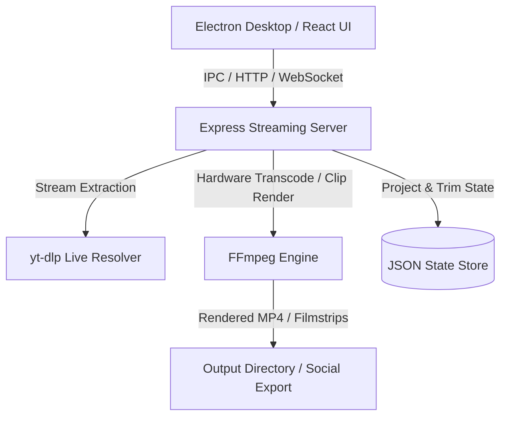

# ISCL Clip Studio 🏏🎬

ISCL Clip Studio is a real-time video clipping and highlight extraction application designed for YouTube Live broadcasts.

It allows users to capture, trim, and export video clips directly from an ongoing live stream without waiting for the broadcast to end or downloading the entire recording first.

Built for the Indian Softball Cricket League (ISCL), it enables match officials and media teams to instantly capture player achievements, boundaries, wickets, milestones, and memorable match moments for social media publishing.

---

## ⚡ Highlights & Key Capabilities

- **Direct Live Stream Ingestion**: Connect to YouTube Live streams, HLS (`.m3u8`) feeds, RTMP streams, or local video files seamlessly.
- **Sub-Second Frame-Accurate Scrubbing**: High-speed scrubbing and frame-stepping (`Left` / `Right` arrows) for pinpoint in-and-out mark extraction.
- **Live Tagging & Marker Presets**: Single-key hotkeys for rapid cricket event labeling (Six, Four, Wicket, Milestone, Celebration, Custom Callout).
- **Multi-Timeline Sequencing**: Create and organize multiple timeline cuts within a single match session.
- **Real-Time Dynamic Overlays**: Built-in broadcast bug generator, team logos (RCB, CSK, Bengaluru Kempegowda, Gadag Gliders, Himachal Titans, KSPL), and sponsor banners.
- **Hardware-Accelerated Export**: Background FFmpeg transcoding engine rendering 1080p60 MP4 exports with NVENC/D3D11 hardware acceleration.
- **Fully Portable Architecture**: One-click zero-install launch scripts (`START_ISCL_STUDIO.bat`) with bundled runtime resolution.

---

## 🏗️ Architecture & Tech Stack



- **Desktop Shell**: [Electron](https://www.electronjs.org/) (Chromium + Node.js runtime) with GPU acceleration and zero-copy rasterization.
- **Frontend**: React, modern CSS design system, responsive timeline track canvas, SVG iconography.
- **Backend Core**: Express.js server, WebSocket broadcast events, Multer asset handling.
- **Media Engine**: FFmpeg static pipeline, `yt-dlp` stream resolution.
- **Data Persistence**: Lightweight local JSON project repository (`server/data/`).

---

## ⌨️ Studio Keyboard Shortcuts

| Shortcut | Action | Description |
| :--- | :--- | :--- |
| <kbd>Space</kbd> | Play / Pause | Toggle live monitor playback |
| <kbd>I</kbd> or <kbd>[</kbd> | Mark In-Point | Set the start boundary for the current clip |
| <kbd>O</kbd> or <kbd>]</kbd> | Mark Out-Point | Set the end boundary for the current clip |
| <kbd>←</kbd> / <kbd>→</kbd> | Frame Step | Step backward or forward by exactly 1 frame |
| <kbd>Del</kbd> / <kbd>Backspace</kbd> | Delete Selection | Remove selected trim or active clip boundary |

---

## 🚀 Getting Started

### 1. One-Click Portable Mode (Recommended for Windows)
Simply double-click:
```cmd
START_ISCL_STUDIO.bat
```
The desktop launcher will resolve local runtimes, start the background video server, and open the native editing studio window.

### 2. Manual Development Mode

#### Prerequisites
- Node.js (v18 or higher)
- FFmpeg added to your system `PATH` (or placed in `bin/`)

#### Backend Setup
```bash
cd server
npm install
npm start
```

#### Desktop Shell Setup (Root)
```bash
npm install
npm start
```
---
### MIT license
